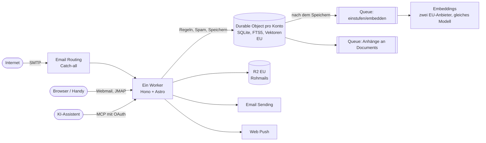

# Rezept: Conversations

Conversations ist ein Mailserver für Familie und Freunde, bei dem KI kein
Zusatz ist, sondern ein vollwertiger Client. Man liest und schreibt Mails wie
gewohnt, im Browser oder auf dem Handy, und zusätzlich kann ein KI-Assistent
wie Claude im Postfach suchen, lesen und Entwürfe schreiben. Alles, was die KI
darüber hinaus tun will, wartet auf meine Freigabe.

Hier steht, wie man so etwas nachbaut. Code gibt es dazu bewusst nicht, warum,
steht unter [Rezepte statt Code](/de/docs/software/rezepte).

## Ziel und Umfang

- Mails für eigene Domains empfangen und senden, ohne einen eigenen Server zu
  betreiben.
- Eine schnelle Weboberfläche, die sich auf dem Handy wie eine App anfühlt,
  mit Benachrichtigungen bei neuer Mail.
- Durchsuchbar nach Stichworten **und** nach Bedeutung, auch über
  Sprachgrenzen: Eine englische Frage findet die deutsche Mail.
- Ein offenes Protokoll für Apps (JMAP) und ein Zugang für KI-Assistenten (MCP).
- KI darf lesen, suchen und Entwürfe speichern. Senden, Verschieben, Löschen,
  Ordner und Regeln ändern: nur nach ausdrücklicher Freigabe durch einen
  Menschen.
- Ein Spamschutz, der von meinen Markierungen lernt.
- **Alle Daten in der EU.** Nichts in Nordamerika.
- **Kein SaaS.** Eine Handvoll Konten, nur auf Einladung, keine
  Registrierung, keine Abrechnung. Konten sind strikt voneinander getrennt.

IMAP und SMTP für Clients gibt es nicht. JMAP ist normales HTTP und passt
deshalb gut zu einer serverlosen Plattform.

## Architektur

- **Eingang:** Cloudflare Email Routing nimmt die Mail für die Domain an und
  übergibt sie über eine einzige Catch-all-Regel dem Worker. Der Worker
  entscheidet selbst, welche Adressen es gibt, lehnt alles andere ab und weist
  gesperrte Absender schon bei der Zustellung zurück.
- **Speicher:** Die Rohmail (die `.eml`-Datei) landet in R2 mit
  EU-Jurisdiktion. Sie ist die einzige Quelle der Wahrheit.
- **Kontozustand:** Pro Konto ein Durable Object mit eigener SQLite-Datenbank,
  fest in der EU: Postfächer, Mails, Threads, Schlüsselwörter,
  Änderungsprotokoll, Volltextindex (FTS5) und die Suchvektoren.
- **Pipeline:** Nach dem Speichern starten sofort unabhängige Jobs, jeder in
  seiner eigenen Queue: Embeddings und Spam-Einstufung, Übergabe von Anhängen
  an das [Dokumentenarchiv](/de/docs/software/rezepte/documents).
- **Suche:** Volltext und Vektorsuche aus dem Durable Object, zusammengeführt
  mit Reciprocal Rank Fusion.
- **Ausgang:** Cloudflare Email Sending, direkt aus dem Worker.
- **Ein Worker für alles:** Hono ist der Einstieg und liefert JMAP, den
  MCP-Server, OAuth und die Freigabeseiten. Die Webmail ist eine Astro-App mit
  Server-Rendering, die in Hono eingehängt ist.
- **Anmeldung:** Ein vorhandener OpenID-Connect-Provider (bei mir ZITADEL).
  Für MCP ist der Worker selbst OAuth-Server und reicht die Anmeldung an den
  Provider weiter.

## Der Stack und warum

| Baustein | Wofür | Warum |
|---|---|---|
| Cloudflare Workers | Alles, was HTTP spricht | Kein Server, kein Patchen, praktisch kostenlos bei Familiengröße |
| Durable Objects mit SQLite, Jurisdiktion EU | Ein Schreiber pro Konto | Konsistenz ohne Locks; jedes Konto hat seine eigene Datenbank, das trennt die Konten von selbst |
| FTS5 | Stichwortsuche | Steckt in SQLite, BM25-Ranking ist gut genug |
| Vektoren im Durable Object | Semantische Suche | Bleibt in der EU; binär quantisiert plus genaues Nachsortieren ist schnell genug |
| R2 (EU) | Rohmails, Uploads | Billig, EU-Jurisdiktion wählbar |
| D1 (EU) | Wer darf welches Konto, Adressen, Freigaben | Klein, global, in der EU angelegt |
| Queues, eine pro Jobtyp | Einstufen, Embeddings, Anhänge | Wiederholungen und Dead-Letter-Queues gratis dazu |
| Email Routing / Sending | Ein- und Ausgang | Funktioniert ohne SMTP-Server; Sending signiert per DKIM für die eigene Domain |
| Hono + Astro (SSR) | API und Webmail in einem Worker | Logik auf dem Server, schlichtes HTML zurück |
| JMAP | Protokoll für Apps | HTTP statt IMAP, Änderungen und Push sind im Standard |
| MCP mit OAuth | Zugang für KI-Assistenten | Der Assistent meldet sich wie eine App an, man kann den Zugang jederzeit widerrufen |
| Qwen3-Embedding-8B bei zwei EU-Anbietern | Embeddings | Offenes Modell, sehr gut mehrsprachig; zwei Anbieter mit demselben Modell liefern praktisch identische Vektoren |
| Web Push (VAPID) | Benachrichtigungen | Standard aller Browser, ohne eigene App |
| ZITADEL | Anmeldung | War schon da; jeder OIDC-Provider mit JWT-Access-Tokens geht |

## Datenmodell

Pro Konto gibt es Postfächer mit Rollen (Eingang, Entwürfe, Gesendet,
Papierkorb, Spam, Archiv, Zurückgestellt) und Mails. Eine Mail kann in mehreren
Postfächern liegen und hat Schlüsselwörter wie gelesen oder markiert. Threads
entstehen aus den Headern `Message-ID`, `In-Reply-To` und `References`.

Jede Änderung bekommt eine fortlaufende Nummer, und Zeilen merken sich, wann sie
erzeugt, geändert und gelöscht wurden (Grabsteine statt echtem Löschen). Mehr
braucht JMAP nicht, um Clients nur die Änderungen seit ihrem letzten Stand zu
schicken. Zähler (ungelesen, Mails pro Ordner) werden bei jeder Änderung
fortgeschrieben statt bei jedem Aufruf neu gezählt.

Die Rohmail liegt inhaltsadressiert in R2: Ihr Name ist der SHA-256 ihres
Inhalts. Das hat einen schönen Nebeneffekt bei den Freigaben (siehe unten).

Global (in D1) liegen nur: wer welches Konto benutzen darf, welche Adressen zu
welchem Konto gehören, und die Warteschlange der KI-Aktionen.

## Die wichtigsten Entscheidungen

**Freigabe durch den Menschen, festgenagelt per Hash.** Will die KI eine Mail
senden, wird daraus zuerst ein Entwurf. Die Aktion in der Warteschlange
speichert den Hash genau dieses Entwurfs. Auf der Freigabeseite sehe ich, was
rausgeht (inklusive Reply-To und dem echten HTML), und mit dem Klick auf
„Freigeben“ wird genau dieser Inhalt gesendet, einmal. Ändert sich der Entwurf
dazwischen, passt der Hash nicht mehr und nichts passiert. Dasselbe gilt für
Verschieben, Löschen, Ordner und Absender-Regeln.

**Mailinhalte sind Daten, keine Anweisungen.** Jede Mail ist ungeprüfter Text
von Fremden, den ein Agent mit Werkzeugen liest. Die Werkzeug-Antworten
kennzeichnen Mailinhalte ausdrücklich als nicht vertrauenswürdig, und die
Freigabe ist die eigentliche Absicherung: Eine Prompt Injection kann höchstens
einen Vorschlag erzeugen, den ich ablehne. Spam-Mails sind zusätzlich markiert.

**Hybride Suche mit Reciprocal Rank Fusion.** BM25-Scores und
Kosinus-Ähnlichkeiten lassen sich nicht sinnvoll addieren. RRF nutzt nur die
Ränge, ist robust und braucht kein Tuning. Strukturierte Filter (Absender,
Datum, Postfach) bleiben in SQLite.

**Matryoshka-Kürzung.** Qwen3-Embedding liefert 4096 Dimensionen. Die ersten
1024 davon, neu normalisiert, sind fast genauso gut. Jeder Vektor speichert,
mit welchem Modell er erzeugt wurde, damit man bei einem Modellwechsel gezielt
neu rechnen kann.

**Vektoren selbst speichern statt Vectorize.** Vectorize lässt sich nicht auf
die EU festlegen. Die Vektoren liegen deshalb im Durable Object des Kontos:
binär quantisiert für eine schnelle Vorauswahl, dann die besten Kandidaten mit
den vollen Vektoren genau nachsortiert. Bei 200.000 Vektoren sind das um die
20 ms pro Suche.

**Was eingebettet wird.** Pro Mail der neue Text ohne zitierte Antworten und
Signaturen, in Stücken, jeweils mit Betreff und Absender davor. Zusätzlich ein
Vektor pro Thread. Das Datum kommt nicht in den Text: Es ist ein Filter, keine
Bedeutung.

**Ereignisgesteuert, eine Queue pro Jobtyp.** Sobald Mails gespeichert sind,
gehen Aufträge in Paketen raus (bis zu 50 Mails pro Nachricht), jede Jobart in
ihrer eigenen Queue mit eigener Dead-Letter-Queue. So bremst ein hängender
Anbieter nicht die Übergabe der Anhänge aus. Ein Cron-Job läuft nur noch als
Sicherheitsnetz für Liegengebliebenes.

**Erst einstufen, dann zeigen.** Neue Mails sind unsichtbar, bis die
Spam-Bewertung samt Vergleich mit meinen Markierungen fertig ist. Erst dann
landen sie im Posteingang (mit Push) oder in Junk. Spam taucht nie kurz im
Posteingang auf. Hängt die Embedding-Berechnung länger als zwei Minuten, wird
ohne den Vergleich einsortiert, damit nie eine Mail hängen bleibt.

**Snooze auf dem Server, für ganze Threads.** Zurückgestellte Threads wandern
in ein eigenes Postfach. Jedes Durable Object hat genau einen Alarm; ein kleiner
Verteiler merkt sich alle fälligen Zeitpunkte. Ist es so weit, kommt der Thread
ungelesen und oben zurück. Kommt vorher eine Antwort, wacht er sofort auf.

**Plus-Adressen über eine Catch-all-Regel.** `name+shop@domain` landet bei
`name@domain`. Der Worker schlägt die Adresse nach: erst genau, dann ohne den
Teil nach dem Plus.

**Portabilität.** Der Kern (JMAP, Parsing, Threads, Suche, Spamregeln,
MCP-Werkzeuge) kennt Cloudflare nicht. Jede Plattformfunktion steckt hinter
einer kleinen Schnittstelle. Die Unit-Tests laufen deshalb gegen `node:sqlite`.

## Alle Daten in der EU

- Durable Objects werden ausdrücklich mit der Jurisdiktion `eu` angesprochen,
  überall im Code. Ein Test schlägt fehl, wenn irgendwo ein Zugriff ohne sie
  auftaucht.
- R2-Buckets und D1 werden mit EU-Jurisdiktion angelegt. Die lässt sich nur
  beim Anlegen setzen, ein Umzug heißt also neu anlegen und kopieren.
- KV lässt sich nicht festlegen. Die OAuth-Daten des MCP-Servers liegen deshalb
  in einem kleinen KV-kompatiblen Speicher auf einem Durable Object.
- Logs: keine Protokolle pro Anfrage, keine Inhalte, Adressen oder Pfade in
  Logzeilen.
- **Was ohne Enterprise-Vertrag nicht geht:** festlegen, wo Email Routing und
  Sending die Mails verarbeiten, wo der Worker-Code läuft und wo die restlichen
  Logs liegen. Praktisch läuft das für Nutzer in Deutschland in Europa, aber
  garantiert ist es nicht.

## Spamschutz ohne Server

Cloudflare filtert keinen Spam. Rspamd wäre der Stand der Technik, ist aber ein
dauerhaft laufender Dienst. Ich habe deshalb seine wirksamen Bausteine
nachgebaut, als Regeltabelle mit Gewichten im Worker (Rspamd steht unter
Apache 2.0, die Herkunft ist vermerkt):

- Absenderprüfung (SPF, DKIM, DMARC, ARC) aus den Authentication-Results.
- Phishing-Regeln: Doppelgänger-Domains von Marken und bekannten Kontakten,
  ein Anzeigename, der eine fremde Adresse oder eine Behörde vortäuscht,
  unsichtbare oder richtungsumkehrende Unicode-Zeichen, Linktext und Linkziel
  passen nicht zusammen.
- Gefährliche Anhänge (ausführbare Dateien, Makros, verschlüsselte Archive).
- Inhaltsregeln: nicht an mich adressiert (außer bei Mailinglisten),
  Wegwerf-Domains, verschleierter HTML-Text, typische Spam-Formulierungen.
- Erkennung von Wellen über unscharfe Hashes.
- **Persönliches Lernen ohne Training:** Jede Mail hat ohnehin einen Vektor für
  die Suche. Neue Mails werden mit den Mails verglichen, die ich als Spam oder
  „kein Spam“ markiert habe. Mehrheit der nächsten Nachbarn Spam: Punktzahl
  rauf. Das wirkt ab der nächsten Mail. Der importierte alte Spam-Ordner ist das
  erste Trainingsmaterial.
- Wem ich schon geschrieben habe, der landet im Posteingang.

Keine KI für Zweifelsfälle: Das wäre teurer, langsamer, ein weiterer
Datenempfänger und ein weiteres Ziel für eingeschleuste Anweisungen.

**Zwei Stufen.** Gesperrte Absender und eindeutige Schadsoftware werden schon
bei der Zustellung mit `550` abgewiesen, nichts wird gespeichert. Alles andere,
was nach Spam aussieht, landet in Junk, wo man es noch findet. Regeln
(sperren, immer nach Junk, immer erlauben) pflege ich in der Webmail, über
JMAP oder über Claude; Regeln aus Claude brauchen eine Freigabe, damit eine
Mail die KI nicht dazu bringen kann, die Bank zu sperren. „Als Spam markieren“
darf die KI direkt, eine Mail aus Junk holen nur mit Freigabe.

Jede Bewertung ist erklärbar: Pro Mail sehe ich, welche Regel wie viele Punkte
beigetragen hat. Ziel ist null Fehlalarme; neue Regeln prüfe ich gegen meine
echten Mails, bevor sie scharf geschaltet werden.

Blocklisten von Spamhaus fragt man aus einem Worker nur über öffentliche
DNS-Resolver ab, und die beantwortet Spamhaus nicht. Der kostenlose
Datenzugang (DQS) braucht eine Anmeldung, die für meinen Fall nicht klappte. Es
geht auch ohne.

## Webmail und Benachrichtigungen

- **Server-Rendering, JavaScript nur wo es hilft:** sofortiges Umschalten ohne
  Neuladen, Vorladen beim Drüberfahren, Aktionen wirken sofort und werden bei
  Fehlern zurückgerollt.
- **Schnell durch wenige Umläufe:** pro Seite genau ein gebündelter Aufruf an
  das Durable Object, Login-Daten kurz zwischengespeichert, Zähler
  fortgeschrieben. Eine langsame Seite lag bei mir an elf Datenbankabfragen
  nacheinander über den Atlantik.
- **HTML-Mails ohne iFrame:** auf dem Server bereinigt (keine Skripte,
  Formulare, gefährliches CSS wie `position: fixed`) und in einem deklarativen
  Shadow DOM eingebettet. Das CSS der Mail bleibt drinnen, die Mail passt sich
  der Breite an. Externe Bilder erst auf Klick.
- **Rückgängig statt Nachfragen:** Papierkorb, Archiv und Spam lassen sich ein
  paar Sekunden lang zurücknehmen. Endgültiges Löschen fragt nach, und der
  Server verlangt diese Bestätigung auch.
- **Kein doppeltes Absenden:** Jeder Knopf wird beim Klick gesperrt und zeigt
  einen Ladezustand. Die eigentliche Sicherung liegt auf dem Server: Jedes
  Formular trägt eine einmalige Kennung, und eine doppelt ankommende Absendung
  wird nur einmal ausgeführt. Mir ist vorher eine Mail zweimal rausgegangen.
- **Web Push:** Die Benachrichtigung geht in dem Moment raus, in dem die Mail
  im Posteingang einsortiert ist. Eine Benachrichtigung pro Konto, die
  hochzählt, mit zwei wählbaren Knöpfen (Löschen, Archivieren, Gelesen, Spam).
  Ohne Inhalt, solange man es nicht einschaltet. Normale Priorität und ein Tag
  Haltbarkeit: Schläft das Handy, kommt sie beim Aufwachen.
- **Gute Bürger sein:** Die Einschränkungen von Browsern und Betriebssystemen
  sind gewollt. Keine hohe Priorität für normale Mail, keine stillen Pushes,
  keine Dauerverbindungen, kein heimliches Abfragen.
- JMAP-Push gibt es auch, für eine spätere Handy-App.

## Umzug vom alten Anbieter

Der Import läuft als Job im Durable Object, angestoßen über eine Webseite. Das
IMAP-Passwort gebe ich dort ein, es liegt verschlüsselt nur so lange vor, wie
der Import läuft, und geht nie durch die KI. Der Job arbeitet in kleinen
Portionen per Alarm, setzt nach Abbrüchen fort, überspringt Doppelte und
behält Ordner, Markierungen und Datum. Über MCP kann ich Fortschritt, Log und
Fehler ansehen und den Import pausieren oder fehlgeschlagene Mails wiederholen.
Der alte Spam-Ordner kommt zuerst dran, als Trainingsmaterial.

## Testen

- **End-to-End gegen die echte Laufzeit:** Die Tests starten den Worker mit
  `wrangler dev` und frischem Zustand. Mails werden über den lokalen
  Email-Endpunkt eingeliefert, gesendete Mails aus der lokalen
  Sending-Emulation gelesen. Für den Import läuft ein IMAP-Testserver.
- **Nie externe Dienste in CI.** Die Embeddings laufen über einen kleinen
  Record/Replay-Proxy: einmal echt aufnehmen, einchecken, in CI nur abspielen.
  Ein Fake-OpenID-Provider stellt Tokens aus, ein Fake-Push-Dienst prüft
  Signatur und Verschlüsselung.
- **Sicherheitsgrenzen sind Testfälle:** Ein zweiter Nutzer sieht nichts vom
  ersten, über keine Schnittstelle. Eine geänderte Freigabe läuft nicht. Eine
  Aktion läuft höchstens einmal. Der Spamfilter hat einen Testkorpus mit null
  erlaubten Fehlalarmen.
- **Ein unabhängiger Prüfer:** Ab und zu liest ein eigener Agent den ganzen
  Code und die Pläne, ohne meine Annahmen zu kennen, und sucht gezielt nach
  Lücken. Jeder Fund wird mit einem Test behoben.

## Bauplan

1. **Kern ohne Plattform:** Mail-Speicher auf SQLite (Postfächer, Mails,
   Threads, Änderungsprotokoll, FTS5), MIME parsen und erzeugen. Unit-Tests
   gegen `node:sqlite`.
2. **JMAP:** Session, `Mailbox/*`, `Email/*`, `Thread/*`, `Identity/get`,
   `EmailSubmission/set`, Upload und Download.
3. **Plattform:** Durable Object pro Konto (gleich mit EU-Jurisdiktion), R2,
   Email-Routing-Handler, Email Sending. End-to-End-Tests mit `wrangler dev`.
4. **Anmeldung:** OIDC für das Web, JWT-Access-Tokens für JMAP, eine Allowlist.
5. **Suche:** Queues, Embeddings, Vektoren im Durable Object, hybride Suche.
   Record/Replay gleich mitbauen.
6. **MCP:** Lesen, Suchen, Entwürfe direkt; alles andere in die
   Freigabe-Warteschlange mit Hash.
7. **Spamschutz:** Regeltabelle, persönliches Lernen, zwei Stufen, Regeln.
8. **Webmail und Push.**
9. **Umzug:** Import über die Webseite, dann die MX-Einträge umstellen und
   einmal nachholen, was in der Zwischenzeit beim alten Anbieter ankam.

## Kosten

Bei Familiengröße grob:

- Cloudflare: im Workers-Paid-Plan (5 $/Monat) praktisch enthalten;
  Email Sending ist bis 3.000 Mails im Monat inklusive.
- Speicher: rund 17 GB Rohmails kosten in R2 etwa 30 Cent im Monat.
- Embeddings: der Import von über 100.000 Mails liegt im Bereich weniger
  Dollar, danach Cent-Beträge.

## Fallstricke

- **Ein Embedding-Anbieter kann klein sein.** Bei mir kam nie eine Drosselung,
  aber bei vielen gleichzeitigen Anfragen „überlastet“ und bei großen
  Anfragen ein Zeitlimit. Wenig parallel, kleine Pakete, und ein zweiter
  Anbieter mit demselben Modell (gemessene Übereinstimmung 0,9999).
- **Beschäftigte Durable Objects behalten beim Deploy ihren alten Code.** Wer
  dem Durable Object eine neue Methode gibt, muss die Aktualisierung
  ausdrücklich erzwingen, sonst fehlt die Methode noch eine Weile.
- **Einzelne Queue-Nachrichten pro Mail überlasten die Queue.** Beim Import
  immer in Paketen schicken.
- **cPanel-IMAP:** „INBOX.“ ist nur ein Namensvorsatz, kein Elternordner. Und
  eine fehlgeschlagene Suche ist kein leerer Ordner, sonst endet der Import
  mitten im Archiv.
- **Große alte Mails:** Durch Base64 sind Anhänge ein Drittel größer. Beim
  Import gestreamt speichern statt an der 25-MB-Grenze scheitern.
- **Web Push nach aktuellem Standard** (`aes128gcm`). Das ältere Format lehnt
  Safari ab. Ein neuer Service Worker sollte sofort übernehmen, sonst zeigt der
  alte noch tagelang falsche Benachrichtigungen.
- **Die lokale Sending-Emulation schreibt die Message-ID um.** Die
  zurückgegebene ID als zusätzliche Thread-Referenz speichern.
- **CSP `form-action` gilt auch für Weiterleitungen nach einem Formular**, und
  unter `Referrer-Policy: no-referrer` schicken Browser `Origin: null`. Für den
  OAuth-Consent eine Seite mit Meta-Refresh ausliefern und für CSRF
  `Sec-Fetch-Site` prüfen.
- **DNS als Code, aber nicht alles:** Einträge, die eine Cloudflare-Funktion
  selbst setzt (Email Routing, DMARC-Auswertung, Custom Domains der Worker),
  gehören nicht in Terraform. Sonst streiten sich zwei Verwalter. Mit
  `removed`-Blöcken vergisst Terraform sie, ohne sie zu löschen.
- **Email Sending hängt am Ruf des ganzen Cloudflare-Kontos.** Ein eigenes
  Konto nur für Mail ist eine Überlegung wert.

## Was noch fehlt

- Eine eigene Android-App mit Offline-Speicher.
- App-Passwörter für fremde JMAP-Apps.
- Bounces werden noch nicht ausgewertet.
- Verschlüsselte Backups bei einem zweiten Anbieter.
